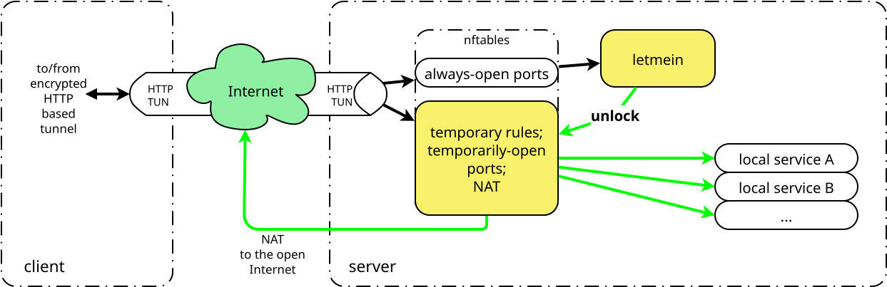

# Example: IPv4/IPv6 tunnel + Letmein protection

This example demonstrates how to configure Httun IPv4/IPv6 tunnel with
[Letmein](https://github.com/mbuesch/letmein)
protection enabled.

Please first read the [TUN example](TUN.md) to understand the basic IPv4/IPv6 tunnel setup before adding Letmein protection.

## Overview

This is an overview picture of the Httun tunnel setup with Letmein protection:

## Server Configuration (`server.conf`)

See the [TUN example](TUN.md).

## Client Configuration (`client.conf`)

See the [TUN example](TUN.md).

## Firewall configuration (nftables)

TODO

## Letmein configuration

TODO
