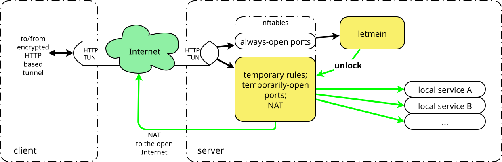

# Example: IPv4/IPv6 tunnel + Letmein protection

This example demonstrates how to configure Httun IPv4/IPv6 tunnel with additional
[Letmein](https://github.com/mbuesch/letmein)
protection for defense-in-depth.

Please first read the [TUN example](TUN.md) to understand the basic IPv4/IPv6 tunnel setup before adding Letmein protection.

## Overview

This is an overview picture of the Httun tunnel setup with Letmein protection:



## Server Configuration (`server.conf`)

See the [TUN example](TUN.md).

## Client Configuration (`client.conf`)

See the [TUN example](TUN.md).

## Firewall configuration (nftables) with Letmein chains

The following `/etc/nftables.conf` defines chains for the Httun tunnel and Letmein protection:

```nft
#!/usr/sbin/nft -f

flush ruleset

table inet nat {
    chain POSTROUTING {
        type nat hook postrouting priority srcnat; policy accept;

        # NAT from httun tunnel to external internet.
        # Please adjust this rule to match your tunnel IP/mask.
        ip saddr 10.10.10.0/24 oifname eth0 counter masquerade
    }
}

table inet filter {
    chain MY-RULES-INPUT {
        # Allow from httun tunnel to this machine.

        # Please adjust this rule to match your tunnel interface name
        # and your specific requirements (e.g. allow only certain ports)
        iifname httun-s-mytun counter accept
    }

    chain MY-RULES-FORWARD {
        # Allow to/from httun tunnel.

        # Please adjust these rules to match your tunnel IP address/mask
        # and your specific requirements (e.g. allow only certain ports)
        ip daddr 10.10.10.0/24 ct state related,established counter accept
        ip saddr 10.10.10.0/24 counter accept
    }

    chain MY-RULES-OUTPUT {
    }

    chain LETMEIN-INPUT {
        # Keep this chain empty.
        # Knocking resource 00000001 will insert a temporary jump to MY-RULES-INPUT here.
    }

    chain LETMEIN-FORWARD {
        # Keep this chain empty.
        # Knocking resource 00000001 will insert a temporary jump to MY-RULES-FORWARD here.
    }

    chain LETMEIN-OUTPUT {
        # Keep this chain empty.
        # Knocking resource 00000001 will insert a temporary jump to MY-RULES-OUTPUT here.
    }

    chain INPUT {
        type filter hook input priority filter; policy drop;
        iifname lo accept
        ct state invalid counter drop
        ct state related,established accept

        # Insert your other input rules here ...

        jump LETMEIN-INPUT

        # Insert your other input rules here ...

        counter reject
    }

    chain FORWARD {
        type filter hook forward priority filter; policy drop;
        ct state invalid counter drop

        # Insert your other forward rules here ...

        jump LETMEIN-FORWARD

        # Insert your other forward rules here ...

        counter reject
    }

    chain OUTPUT {
        type filter hook output priority filter; policy drop;
        oifname lo accept
        ct state invalid counter drop
        ct state related,established accept

        # Insert your other output rules here ...

        jump LETMEIN-OUTPUT

        # Insert your other output rules here ...

        counter reject
    }
}
```

## Letmein configuration

With the following `letmeind.conf` configuration the `MY-RULES-INPUT`, `MY-RULES-FORWARD` and `MY-RULES-OUTPUT` nftables chains can be enabled by "knocking" the `00000001` resource.

```ini
[GENERAL]
port = 5800 / udp
control-error-policy = basic-auth
seccomp = kill

[NFTABLES]
family = inet
table = filter
chain-input = LETMEIN-INPUT
chain-forward = LETMEIN-FORWARD
chain-output = LETMEIN-OUTPUT

[KEYS]
00000000 = YOUR_GENERATED_LETMEIN_SECRET_KEY_HERE

[RESOURCES]
00000001 = jump /
           input: MY-RULES-INPUT / forward: MY-RULES-FORWARD / output: MY-RULES-OUTPUT /
           input-match: saddr /
           users: 00000000 /
           timeout: 120
```

Please read the [Letmein configuration documentation](https://github.com/mbuesch/letmein/blob/master/doc/CONFIGURATION.md) for details.
